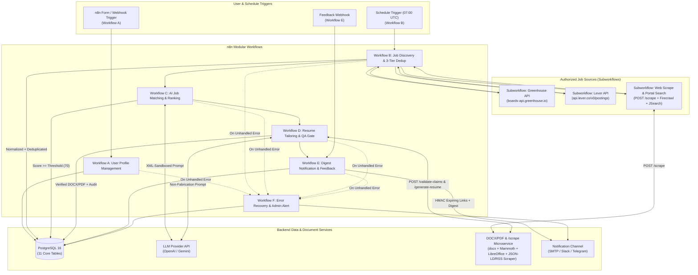

# AI Job Search & Resume Tailoring Automation (n8n + PostgreSQL + DOCX/PDF Service)

Production-ready backend automation package for discovering jobs from authorized job board APIs, normalizing and deduplicating listings in PostgreSQL, scoring suitability with transparent LLM weights, tailoring ATS-friendly resumes under strict non-fabrication QA gates, generating verified DOCX/PDF files, and delivering digests with expiring download links.

---

## 1. Repository Directory Structure

```text
├── .env.example                                     # Environment variables & secret templates
├── docker-compose.yml                               # Orchestrates PostgreSQL 16, n8n, and docx-service
├── db/
│   └── init/
│       ├── 01_schema.sql                            # 11 tables, constraints, indexes, retention stored proc
│       └── 02_seed.sql                              # Seed user, preferences, master resume, 2 job sources
├── docx-service/
│   ├── Dockerfile                                   # Node 22 + LibreOffice Writer container
│   ├── package.json                                 # Express, docx, mammoth, pdfkit
│   └── src/
│       ├── core.js                                  # Pure QA claim verifier, dedup hashing, HMAC signing
│       ├── core.test.js                             # Unit tests (node --test)
│       └── server.js                                # REST endpoints (/generate-resume, /validate-claims, /download)
├── prompts/
│   └── prompt_templates.md                          # Job Matching, Resume Tailoring & QA Prompts
├── test-data/
│   ├── sample_master_resume.json                    # Verified Master Resume fixture
│   └── sample_job_postings.json                     # E2E test scenarios (Strong Match, Low Match, Prompt Injection)
└── workflows/
    ├── workflow_a_user_profile_management.json      # Workflow A: Form/Webhook User Profile & Preferences
    ├── workflow_b_scheduled_job_discovery.json      # Workflow B: Scheduled Job Discovery & Deduplication
    ├── workflow_c_job_evaluation.json               # Workflow C: LLM Job Matching & Weighted Ranking
    ├── workflow_d_resume_tailoring.json             # Workflow D: Resume Tailoring Agent & Claim QA Loop
    ├── workflow_e_notification_and_feedback.json    # Workflow E: Digest Delivery & Feedback Webhook
    ├── workflow_f_monitoring_and_error_recovery.json# Workflow F: Global Error Trigger, Audit & Admin Alert
    ├── subworkflow_source_greenhouse.json           # Reusable Subworkflow: Greenhouse Job Board API
    ├── subworkflow_source_lever.json                # Reusable Subworkflow: Lever Postings API
    ├── subworkflow_source_web_scrape.json           # Reusable Subworkflow: POST /scrape (Career Pages, RSS, JSON-LD, Firecrawl & JSearch)
    └── subworkflow_document_generation.json         # Reusable Subworkflow: DOCX/PDF Generation & Verification
```

---

## 2. System Architecture Diagram



---

## 3. Node-by-Node Workflow Specification

### Workflow A: User Profile Management (`workflows/workflow_a_user_profile_management.json`)
1. **Webhook: Update User Profile / Form Trigger: Job Profile**: Accepts user configuration via HTTP POST `/webhook/user-profile` or interactive n8n web form.
2. **Code: Normalize & Validate Profile Input**: Validates email, target job titles, skills, preferred/excluded companies, min match score (default `70`), max jobs per run (`15`), and notification channel.
3. **IF: Profile Input Valid?**: Routes invalid payloads to a `400 Bad Request` response node.
4. **Postgres: Upsert User**: Upserts record in `users` (including `schedule_enabled` flag to pause/resume scheduled runs without editing workflows).
5. **Postgres: Upsert User Preferences**: Persists all 17 preference attributes and configurable `scoring_weights` in `user_preferences`.
6. **Postgres: Record Profile Audit Event**: Writes an immutable `USER_PROFILE_UPDATED` record to `audit_events`.
7. **Respond to Webhook**: Returns JSON confirmation.

### Workflow B: Scheduled Job Discovery (`workflows/workflow_b_scheduled_job_discovery.json`)
1. **Schedule Trigger: Daily 07:00 UTC**: Initiates discovery run.
2. **Postgres: Load Active User & Schedule Gate**: Checks `users.is_active = TRUE AND users.schedule_enabled = TRUE`. If disabled, stops cleanly.
3. **Postgres: Start Workflow Run**: Creates a `running` entry in `workflow_runs`.
4. **Postgres: Load Enabled Job Sources**: Loads configured sources from `job_sources`.
5. **Execute Subworkflow: Greenhouse Source & Lever Source**: Runs each portal independently with `continueOnFail: true` so one failed source never halts the run.
6. **Merge + Code: Filter & 3-Tier Deduplicate Jobs**: Filters out `excluded_companies`, matches target title keywords, and deduplicates across `(source, job_id)`, `canonical_url` (with tracking params stripped), and `fallback_dedup_hash` (`SHA-256(company|title|location)`).
7. **Postgres: Upsert Normalized Jobs**: Inserts new jobs or updates `last_seen_at`. Only resets `status = 'discovered'` if `description_sha256` materially changed.
8. **Postgres: Complete Workflow Run**: Marks `workflow_runs` as `completed` with metrics.

### Workflow C: Job Evaluation (`workflows/workflow_c_job_evaluation.json`)
1. **Postgres: Fetch Unscored or Materially Changed Jobs**: Queries jobs that do not yet have a `job_matches` entry for the current `(description_sha256, resume_sha256)` pair—guaranteeing idempotency across retries.
2. **HTTP Request: LLM Job Match Evaluation**: Sends the candidate profile, master resume, and `<untrusted_job_description>` to the LLM with `response_format: { type: "json_object" }`.
3. **Code: Parse Match JSON & Apply Threshold**: Computes the transparent breakdown out of 100 (Technical Skills: 35, Experience: 25, Role Alignment: 20, Location/Work Mode: 10, Seniority/Industry: 10) and flags `qualifies_for_tailoring = (overall_match_score >= min_match_score)`.
4. **Postgres: Persist Job Match Score & Update Job Status**: Saves structured evaluation to `job_matches` and updates `jobs.status` to `qualified` or `below_threshold`.

### Workflow D: Resume Tailoring & QA Verification (`workflows/workflow_d_resume_tailoring.json`)
1. **Postgres: Load Qualifying Jobs Pending Tailoring**: Selects `job_matches` where `qualifies_for_tailoring = TRUE` and no `tailored_resumes` record exists.
2. **HTTP Request: LLM Resume Tailoring Agent**: Generates a job-specific structured resume strictly constrained to the facts in `source_resume`.
3. **HTTP Request: Automated QA & Claim Verification**: Calls `docx-service` `POST /validate-claims` to verify employment dates, company names, roles, education, certifications, skills inventory, quantitative metrics (`%`, `$`), and absence of prompt leakage.
4. **IF: Passed Claim Verification?**:
   - **True**: Calls `Subworkflow: Document Generation & File QA` (`POST /generate-resume`) which builds `CompanyName_Role_Resume_YYYY-MM-DD.docx` and `.pdf`, re-parses the generated DOCX with Mammoth to confirm readability, generates HMAC-SHA256 expiring download links, and saves the record in `tailored_resumes` with `qa_status = 'passed'`.
   - **False**: Flags the record in `tailored_resumes` as `qa_status = 'failed_manual_review'` with the detailed violation report so unverified claims are never delivered as verified.

### Workflow E: Notification & User Feedback (`workflows/workflow_e_notification_and_feedback.json`)
1. **Postgres: Load Undelivered Verified Resumes**: Queries `tailored_resumes` (`qa_status = 'passed'`) that have not yet been sent in `notifications`.
2. **Code: Build Digest Email & Idempotency Key**: Groups qualifying matches into an HTML digest containing job title, company, location/work mode, match score, explanation, missing skills, direct application URL, resume version ID, and expiring download links. Computes a deterministic `idempotency_key`.
3. **Send Email: Deliver Digest**: Sends via SMTP (`continueOnFail: true`).
4. **Postgres: Record Notification Sent**: Inserts into `notifications` with `ON CONFLICT (idempotency_key) DO NOTHING`.
5. **Webhook: Capture User Job Feedback**: Exposes `POST /webhook/job-feedback` allowing the user to mark jobs as `interested`, `not_interested`, `already_applied`, `interview_scheduled`, `rejected`, or `offer_received` in `application_tracking` while keeping `approval_required = TRUE`.

### Workflow F: Monitoring & Error Recovery (`workflows/workflow_f_monitoring_and_error_recovery.json`)
1. **Error Trigger**: Captures any unhandled node or workflow failure across Workflows A–E.
2. **Postgres: Log Failed Execution Run & Audit Event**: Logs the execution ID, failed node name, and error message to `workflow_runs` and `audit_events`.
3. **Send Email: Alert Administrator**: Dispatches an immediate failure alert to `ADMIN_ALERT_EMAIL`.

---

## 4. Setup & Deployment Instructions (Local / Docker Compose)

### Prerequisites
- Docker Engine 24+ and Docker Compose v2
- An OpenAI API Key (or Google Gemini API Key)
- An SMTP account (e.g., Gmail App Password, Amazon SES, or Mailpit for local testing)

### Step-by-Step Launch
1. **Configure Environment Variables**:
   ```bash
   cp .env.example .env
   ```
   Edit `.env` and set strong values for `POSTGRES_PASSWORD`, `N8N_ENCRYPTION_KEY`, `DOCX_SERVICE_API_KEY`, `DOCX_URL_SIGNING_SECRET`, `OPENAI_API_KEY`, and `SMTP_*`.

2. **Start the Stack**:
   ```bash
   docker compose up -d --build
   ```
   - PostgreSQL 16 initializes `01_schema.sql` and `02_seed.sql` automatically on first boot.
   - `docx-service` starts on `http://localhost:3001` (verify via `curl http://localhost:3001/health`).
   - `n8n` starts on `http://localhost:5678`.

3. **Configure n8n Credentials**:
   Open `http://localhost:5678` and create three credentials in **Settings -> Credentials**:
   - **PostgreSQL Job Automation DB** (`postgres`): Host `postgres`, Database `job_automation_db`, User `n8n_admin`, Password from `.env`, Port `5432`.
   - **OpenAI API Key** (`openAiApi`): Your `OPENAI_API_KEY`.
   - **SMTP Email Account** (`smtp`): Host, Port, User, and Password from `.env`.

4. **Import Workflows**:
   Import all JSON files from `/workflows/` into n8n (or via CLI inside the container):
   ```bash
   docker exec -u node job_auto_n8n n8n import:workflow --separate --input=/home/node/workflows
   ```

---

## 5. Manual Test Plan (Before Enabling Scheduled Execution)

Run this checklist in order before activating the `Schedule Trigger` in Workflow B:

1. **Verify Microservice Unit Tests & Health**:
   ```bash
   cd docx-service && npm test
   curl -s http://localhost:3001/health
   ```
2. **Test Workflow A (Profile Update & Schedule Gate)**:
   ```bash
   curl -X POST http://localhost:5678/webhook-test/user-profile \
     -H "Content-Type: application/json" \
     -d '{
       "email": "alex.mercer.devops@example.com",
       "full_name": "Alex Mercer",
       "target_job_titles": ["DevOps Engineer", "Platform Engineer"],
       "years_of_experience": 6.5,
       "technical_skills": ["AWS", "Kubernetes", "Terraform", "GitHub Actions", "Python"],
       "preferred_locations": ["Remote", "Seattle, WA"],
       "min_match_score": 70,
       "max_jobs_per_run": 10,
       "schedule_enabled": true
     }'
   ```
   Confirm `user_preferences` and `audit_events` updated in PostgreSQL.
3. **Test Subworkflows (Greenhouse & Lever Discovery)**:
   Execute `Subworkflow: Greenhouse Job Discovery` and `Subworkflow: Lever Job Discovery` manually in the n8n UI. Confirm normalized job items are returned and that an invalid board token does not crash the subworkflow (`continueOnFail: true`).
4. **Test Workflow C & D with Sample Fixtures (`/test-data/sample_job_postings.json`)**:
   - Verify `E2E-01-STRONG-MATCH` scores >= 70, triggers `Workflow D`, passes `/validate-claims`, and creates `Datadog_Senior_DevOps_Platform_Engineer_Resume_YYYY-MM-DD.docx` and `.pdf` in `/data/resumes`.
   - Verify `E2E-02-BELOW-THRESHOLD` scores < 70 and is marked `below_threshold` without generating a resume.
   - Verify `E2E-03-PROMPT-INJECTION-ATTEMPT` does not override the score or inject unverified skills into the resume.
5. **Test Expiring Download Link**:
   Open the `docx_download_url` returned by `/generate-resume` in a browser; verify the DOCX opens cleanly in Word/LibreOffice. Modify the `sig` query parameter and confirm `403 Forbidden` is returned.
6. **Test Workflow E Feedback Loop**:
   ```bash
   curl -X POST http://localhost:5678/webhook-test/job-feedback \
     -H "Content-Type: application/json" \
     -d '{
       "user_id": "11111111-1111-4111-8111-111111111111",
       "job_uuid": "<JOB_UUID_FROM_DB>",
       "feedback_status": "interested",
       "user_notes": "Great team alignment, ready to review application manually."
     }'
   ```
7. **Test Disabling Scheduled Runs**:
   Set `schedule_enabled = FALSE` on the user record via Workflow A or SQL (`UPDATE users SET schedule_enabled = FALSE WHERE email = 'alex.mercer.devops@example.com';`) and confirm Workflow B exits immediately at the gate node.

---

## 6. Error Handling, Monitoring & Troubleshooting

| Symptom / Failure Mode | Root Cause | Built-In Recovery & Troubleshooting Action |
| :--- | :--- | :--- |
| **Single Job Portal API Timeout / 429** | Rate limit or temporary outage on Greenhouse/Lever | HTTP Request nodes retry 3x with backoff (`waitBetweenTries: 2000ms`) and use `continueOnFail: true` so healthy portals still complete. |
| **Duplicate Resumes on Workflow Retry** | Workflow retried after partial failure | `job_matches` enforces `UNIQUE (job_uuid, user_id, description_sha256, resume_sha256)` and `tailored_resumes` enforces `UNIQUE (job_match_id)`. Retries skip already-processed jobs. |
| **Duplicate Digest Emails Sent** | Notification step retried | `notifications.idempotency_key` (`UNIQUE`) blocks duplicate digest sends for the same user and resume batch. |
| **QA Claim Verification Fails (`422`)** | LLM hallucinated a skill, metric, or altered a date | `validateTailoredResumeAgainstSource` catches the discrepancy and Workflow D records `qa_status = 'failed_manual_review'` in `tailored_resumes` with exact error reasons in `qa_report_json`. |
| **Data Retention & GDPR Deletion** | Old job listings or user requests deletion | Call `SELECT purge_expired_user_data('11111111-1111-4111-8111-111111111111');` or `DELETE FROM users WHERE id = ...` (`ON DELETE CASCADE` removes all linked records). |
